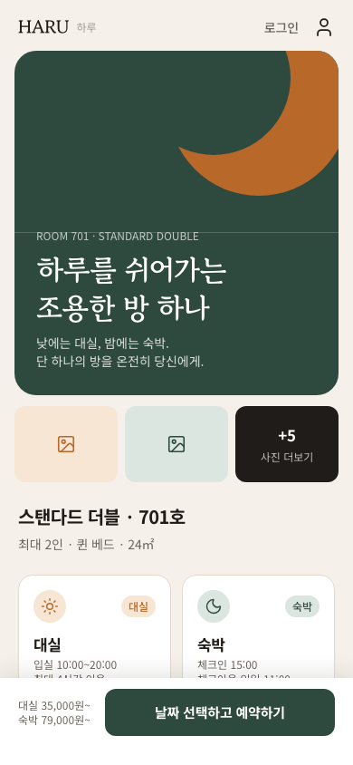
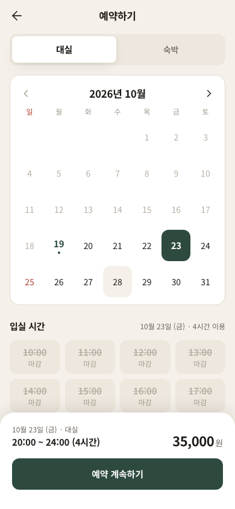
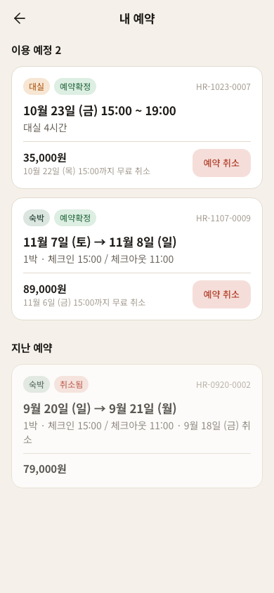
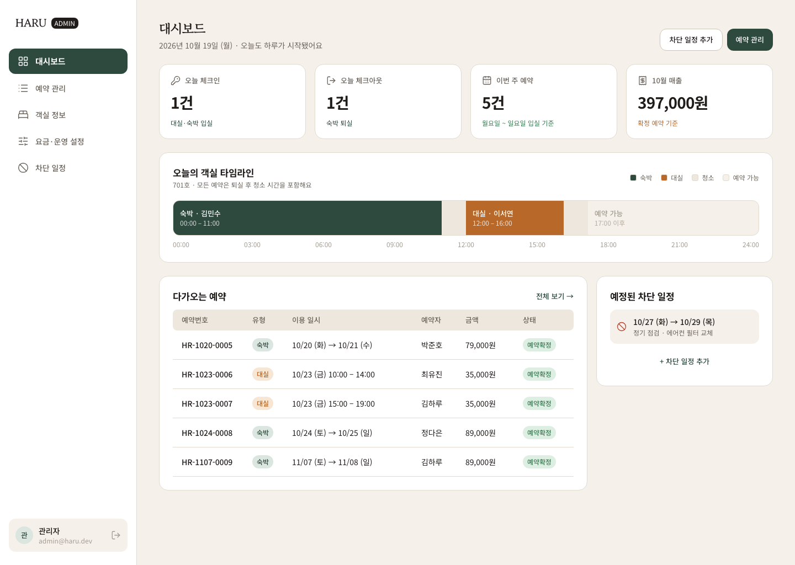

# HARU · 호텔방 대실·숙박 예약

객실 하나를 낮에는 **대실**, 밤에는 **숙박**으로 파는 예약 사이트와 관리자 페이지예요. 포트폴리오/학습용 프로젝트라 결제는 모의 결제로 처리해요.

- 디자인(Figma): https://www.figma.com/design/8rIYX31Lxdsoy8eHinf4ub
- 설계 문서: [`docs/superpowers/specs/2026-10-19-hotel-booking-design.md`](docs/superpowers/specs/2026-10-19-hotel-booking-design.md)
- 기술 스택: FastAPI, SQLAlchemy 2, Alembic, PostgreSQL 16 (백엔드) · Next.js 16, React 19, Tailwind 4, TanStack Query (프론트엔드)

| 홈 | 대실 예약 | 내 예약 |
|---|---|---|
|  |  |  |



## 실행

필요한 도구는 [uv](https://docs.astral.sh/uv/)와 Docker예요.

```bash
docker compose up -d                       # PostgreSQL (localhost:5433, DB: haru / haru_test)
cd backend
uv sync
uv run alembic upgrade head
uv run python -m app.seed                  # 데모 데이터 (여러 번 실행해도 안전)
uv run fastapi dev app/main.py             # http://localhost:8000/docs
```

프론트엔드는 백엔드가 떠 있는 상태에서 실행해요. `/api`, `/uploads` 요청은 Next가 백엔드로 프록시해요.

```bash
cd frontend
npm install
npm run dev                                # http://localhost:3000 (관리자: /admin)
```

API 스펙이 바뀌면 `npm run gen:api`로 타입(`src/lib/api/schema.d.ts`)을 다시 만들어요.

데모 계정:

| 역할 | 이메일 | 비밀번호 |
|---|---|---|
| 관리자 | admin@haru.dev | admin1234 |
| 손님 | haru@example.com | haru1234 |

## 테스트

```bash
cd backend && uv run pytest
```

테스트는 `haru_test` DB에 마이그레이션을 적용한 뒤 실행돼요. 테스트 기준 시각은 2026-10-19 09:00 KST(월요일)로 고정돼 있어요.

```bash
cd frontend
npm test                                   # 단위·컴포넌트 테스트 (Vitest)
npm run test:tz                            # 브라우저 시간대가 LA여도 KST로 계산되는지
npx playwright install chromium            # 처음 한 번
npm run e2e                                # E2E (Playwright)
```

E2E는 전용 DB(`haru_e2e`, 실행할 때마다 초기화하고 seed)와 별도 포트(백엔드 8100, 프론트 3100)를 써요. 그래서 개발 서버를 켜 둔 채로 돌려도 돼요. 프론트엔드는 프로덕션 빌드로 띄우고, 모바일 시나리오는 `America/Los_Angeles` 시간대 브라우저로 실행해서 화면 시각이 KST로 나오는지 확인해요. README 스크린샷은 `SCREENSHOTS=1 npm run e2e -- screenshots`로 다시 만들어요.

## 설계 포인트

### 1. 모든 예약은 시간 구간이고, 겹침은 DB가 막아요

대실과 숙박을 따로 다루지 않고 모두 `[start_at, end_at)` 구간으로 저장해요. 여기에 청소 시간까지 더한 `blocked_until`을 함께 저장해요.

```sql
EXCLUDE USING gist (room_id WITH =, tstzrange(start_at, blocked_until, '[)') WITH &&)
WHERE (status = 'CONFIRMED')
```

이 제약 하나로 아래 규칙이 별도 코드 없이 지켜져요.

- 숙박 11:00 체크아웃 → 청소 1시간 → 12:00부터 대실 가능
- 같은 날 15:00 숙박이 있으면 대실은 14:00까지 끝나야 함

여러 명이 같은 시각에 예약해도 한 명만 성공하고, 나머지는 500이 아니라 409를 받아요. 예약과 차단을 쓰기 전에 객실 행을 잠그기(`SELECT … FOR UPDATE`) 때문이에요. 이렇게 하면 겹침 제약 검사가 서로를 기다리다 교착(`40P01`)에 빠지지 않아요. 겹침 제약은 마지막 안전장치로 남겨둬요.

### 2. 차단 일정도 같은 테이블에 있어요

점검 같은 차단 일정은 `type = 'BLOCK'` 행으로 저장해요. 그래서 같은 제약이 예약과 차단 사이의 겹침도 막아줘요. 테이블을 나눴다면 두 테이블에 걸친 경쟁 조건을 따로 처리해야 했을 거예요.

### 3. 시간대는 KST 기준이에요

- DB에는 `timestamptz`로 저장해요.
- "오늘", 요일 요금, 영업시간 같은 규칙은 서버 시간대와 상관없이 `Asia/Seoul` 기준으로 계산해요.
- API 응답의 시각은 `+09:00` 오프셋으로 내려가요.
- 취소 마감 같은 정책은 예약할 때 예약 행에 같이 저장해요(`blocked_until`, `cancel_deadline_at`). 그래서 어드민이 나중에 설정을 바꿔도 이미 있는 예약에는 적용되지 않아요.
- 현재 시각은 `get_now()` 의존성 하나에서만 가져와요. 그래서 테스트에서 시각을 고정하거나 바꿀 수 있어요(취소 마감 경계, 자정 직후 등).

### 4. 디자인 시스템

색상, 간격, 글꼴은 Figma 변수와 텍스트 스타일을 같은 이름으로 Tailwind `@theme` 토큰(`frontend/src/app/globals.css`)에 옮겼어요. 버튼, 배지, 달력 칸, 시간 칩, 입력창은 Figma 컴포넌트와 1:1로 대응해요. 파비콘, 앱 아이콘(PWA·iOS), 스플래시도 Figma에서 디자인한 같은 로고를 써요.

### 구조

```
backend/app/
  domain/     요금, 시간 구간, 예약 가능 여부 (DB를 모르는 순수 함수)
  services/   예약·차단 생성/취소/조회, 모의 결제
  api/        auth · public(객실/가능 여부/견적) · reservations · admin
frontend/src/
  app/(site)/ 손님 화면 (홈, 예약, 결제, 내 예약, 로그인)   app/admin/ 관리자 화면
  components/ui/  디자인 시스템 부품     features/  화면별 로직
  lib/        API 클라이언트(OpenAPI 타입), KST 시간 유틸, 오류 메시지
```

## 주요 API

| 메서드 | 경로 | 설명 |
|---|---|---|
| POST | `/api/auth/signup` · `/login` · `/logout`, GET `/api/auth/me` | httpOnly 쿠키 세션 |
| GET | `/api/room` | 객실 정보 + 요금·운영 규칙 |
| GET | `/api/availability/dayuse?date=` · `/stay?month=` | 대실 슬롯 / 숙박 가능일 |
| POST | `/api/quotes` | 견적 (가능 여부와 사유 포함) |
| POST | `/api/reservations`, GET `/me`, POST `/{id}/cancel` | 예약(모의 결제) · 내 예약 · 취소 |
| GET | `/api/admin/dashboard` | KPI, 오늘의 타임라인, 다가오는 예약 |
| GET/POST | `/api/admin/reservations…` | 목록·필터·상세·취소 |
| GET/PUT | `/api/admin/settings` | 요금, 운영 시간, 청소 시간, 취소 마감 |
| GET/POST/DELETE | `/api/admin/blocks` | 차단 일정 |
| PUT / POST / DELETE | `/api/admin/room`, `/room/photos` | 객실 정보, 사진 |

전체 스펙은 서버 실행 후 `/docs`에서 볼 수 있어요.
