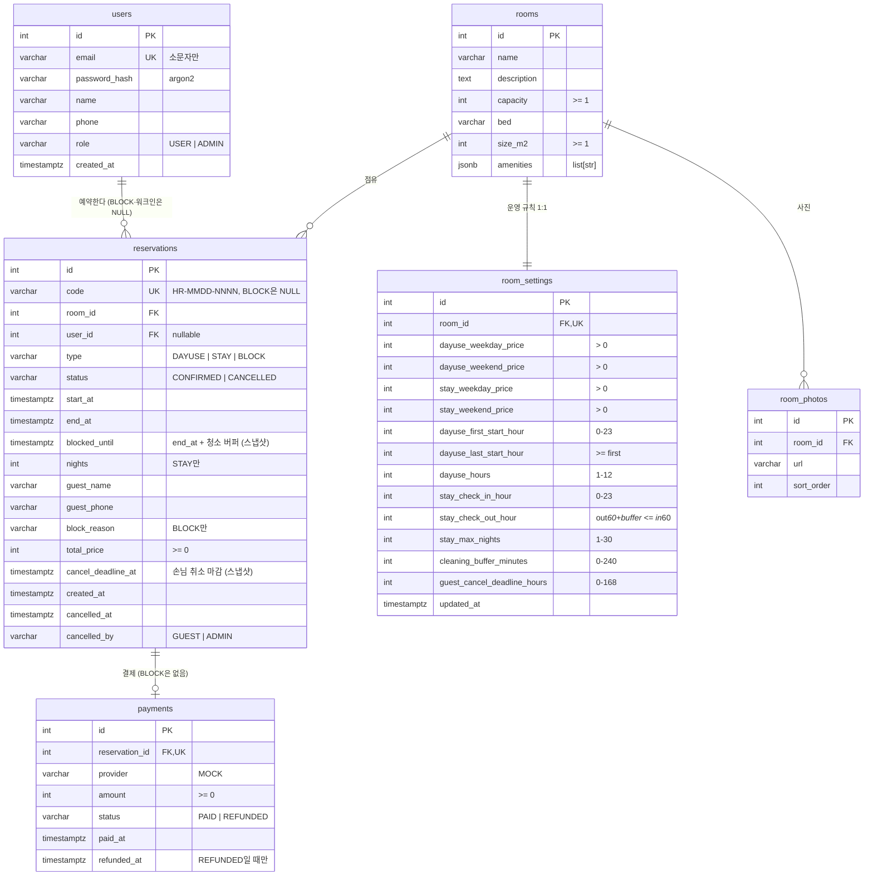

# HARU 데이터 모델 (ERD)

PostgreSQL 16, 마이그레이션 `backend/alembic/versions/0001`~`0003`. 시각은 모두 `timestamptz`(UTC 저장, 규칙은 Asia/Seoul).

## 설계 원칙

- **하나의 점유 테이블:** 대실, 숙박, 차단 일정이 모두 `reservations`에 들어가요.
  - 겹침은 `reservations_no_overlap` 하나가 막아요. `EXCLUDE USING gist (room_id WITH =, tstzrange(start_at, blocked_until, '[)') WITH &&) WHERE status = 'CONFIRMED'`
  - 같은 GiST 인덱스가 예약 가능 여부 조회(`busy_query`)에도 쓰여요. 쿼리를 같은 `tstzrange … &&` 식으로 썼기 때문이에요.
- **정책 스냅샷:** `blocked_until`(청소 시간)과 `cancel_deadline_at`(취소 마감)은 예약할 때 행에 저장해요. 그래서 어드민이 설정을 바꿔도 기존 예약에는 소급 적용되지 않아요.
- **상태는 최소한만 저장:** `COMPLETED`는 저장하지 않아요. API가 `end_at <= now`로 계산해요.
- **동시성 (서버 여러 대가 DB 하나를 같이 쓰는 경우 포함):**
  - **먼저 잠금 없이 확인:** 예약 요청은 잠금 없이 먼저 가능 여부를 확인해요. 이미 찬 자리면 바로 409를 돌려줘요.
  - **날짜 단위 잠금:** 가능하면 예약 구간이 걸친 KST 날짜마다 advisory lock을 걸어요(`pg_try_advisory_xact_lock(room, day)`).
    - 날짜 순서대로 잡아서 교착이 생기지 않아요.
    - 겹치는 두 구간은 반드시 같은 날짜를 하나 이상 공유해서 서로 기다리게 돼요. 다른 날짜끼리는 기다리지 않아요.
    - 잠금이 비어 있지 않으면 커넥션을 반납하고, 랜덤 간격으로 잠깐 기다렸다가 다시 확인해요. 3초가 지나면 503(재시도 가능)을 돌려줘요.
    - 겹침 제약(`reservations_no_overlap`)은 마지막 안전장치예요.
  - **취소:** 예약 행을 `FOR UPDATE`로 잠가서 환불이 한 번만 일어나요.
  - **커넥션 예산:** 프로세스당 커넥션은 최대 10개예요(`db_pool_size` + `db_max_overflow`). `get_db`가 이벤트 루프에서 커넥션 자리를 먼저 확보한 뒤 요청을 작업 스레드로 넘겨요. 그래서 스레드는 커넥션을 기다리며 막히지 않아요.
  - **비밀번호 해시:** argon2(해시 1번에 64MB)는 DB 커넥션 없이 처리하고, 프로세스당 동시 4개로 제한해요.

## 무결성 제약 (DB가 직접 보장)

| 제약 | 내용 |
|---|---|
| `reservations_kind_shape` | 행은 아래 세 모양 중 하나여야 함 |
| `reservations_cancel_state` | `status = 'CANCELLED'` ⇔ `cancelled_at`과 `cancelled_by`가 둘 다 있음 |
| `reservations_window` | `start_at < end_at <= blocked_until` |
| `reservations_price_nonneg`, `payments_amount_nonneg` | 금액 ≥ 0 |
| `payments_refund_state` | `status = 'REFUNDED'` ⇔ `refunded_at`이 있음 |
| `users_email_lower` | 이메일은 소문자로만 저장(대소문자 무시 유일성) |
| `room_settings_*` | 요금 > 0, 시간 범위, 첫 입실 ≤ 마지막 입실, 체크아웃 + 청소 시간 ≤ 체크인 |
| `rooms_sizes` | 인원과 면적 ≥ 1 |

`reservations_kind_shape`가 허용하는 세 모양이에요.

- **BLOCK:** 사용자 없음, 가격 0, 박수 없음, 사유 필수, 취소 마감 없음, 버퍼 없음(`end_at = blocked_until`)
- **DAYUSE:** 박수 없음, 취소 마감과 손님 이름 필수
- **STAY:** 박수 ≥ 1(NULL 불가), 취소 마감과 손님 이름 필수

## 인덱스와 사용처

벤치마크는 예약 5만 건 기준이에요. 실행 시간은 `EXPLAIN ANALYZE`로 쟀어요.

| 인덱스 | 쓰는 쿼리 | 이전 → 이후 |
|---|---|---|
| `reservations_no_overlap` (GiST, 부분) | 예약 가능 여부, 견적, 예약 생성의 겹침 조회 | 8.3ms → 0.5ms |
| `ix_reservations_user_start (user_id, start_at)` | 내 예약 | 2.2ms → 0.12ms |
| `ix_reservations_start_at` | 어드민 목록(기간), 대시보드 | 4.2ms → 0.04ms |
| `ix_reservations_{code,guest_name,guest_phone}_trgm` (GIN, pg_trgm) | 어드민 검색 `ILIKE '%q%'` | 55ms → 0.12ms |
| `ix_reservations_blocks_upcoming` (부분: BLOCK·CONFIRMED) | 차단 일정 목록 | 4.6ms → 0.006ms |
| `ix_room_photos_room_sort (room_id, sort_order)` | 객실 사진(정렬) | — |
| `payments_reservation_id_key`, `users_email_key`, `reservations_code_key` | 유일성 및 FK 조회 | — |

목록 정렬은 항상 `(start_at, id)`예요. 같은 시각에 시작하는 행이 있어도 페이지가 겹치거나 빠지지 않아요. 검색어의 `%`, `_`는 와일드카드가 아니라 문자 그대로 검색해요.
